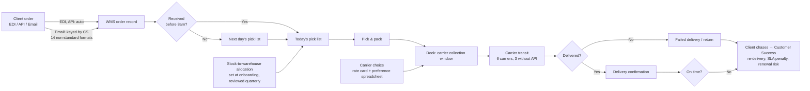
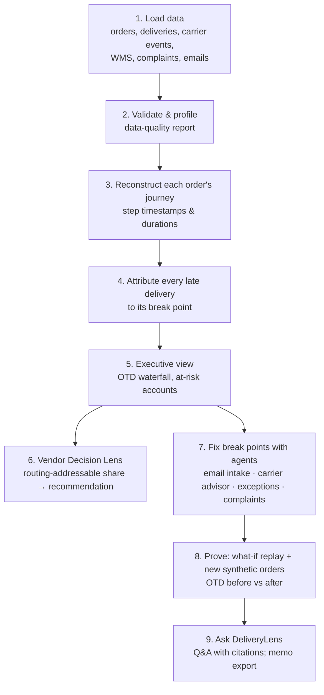
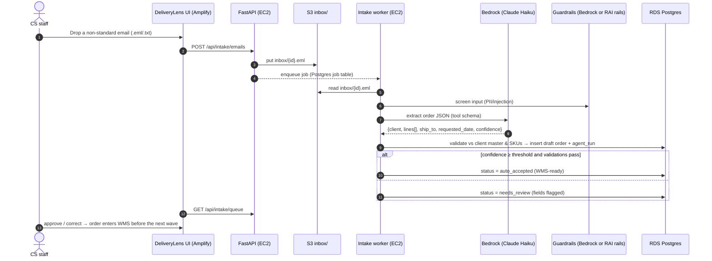
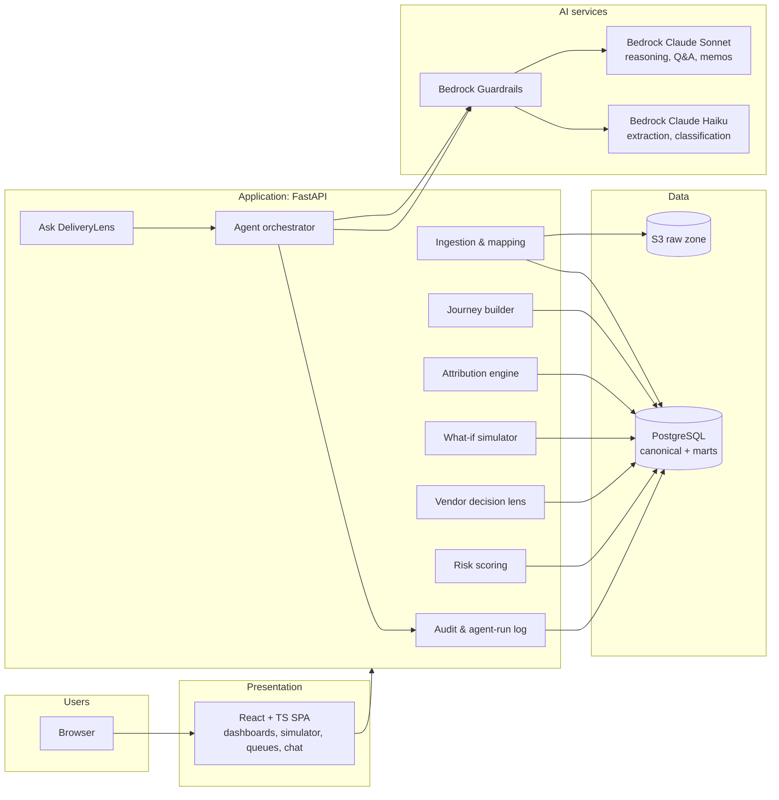
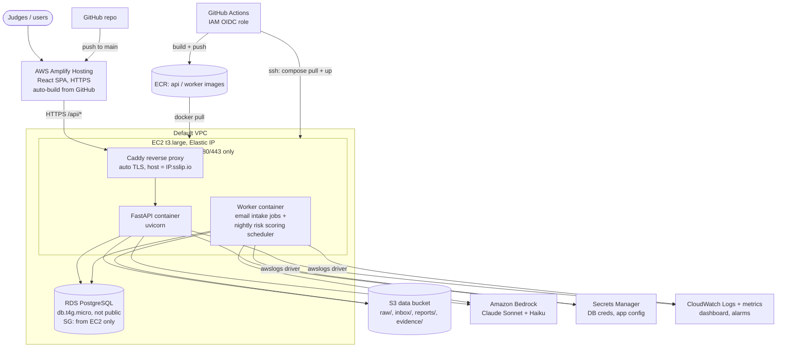
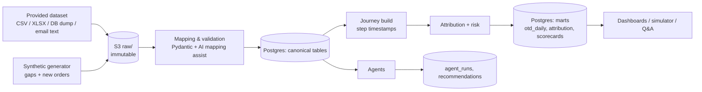
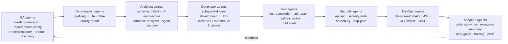

# Halcyon DeliveryLens: solution design, AWS architecture and 5-day execution plan

**Problem 2 · Late deliveries at Halcyon Logistics** · EvoHack 2026 · AWS · **Team InfinityStacks**
(Sravan Kumar D · Sai M · Dinesh K)

**Built only on the AWS services the team requested** (`01-infra-request.md`): Amazon Bedrock
(Claude) · IAM · S3 · ECR · Secrets Manager · RDS PostgreSQL · CloudWatch · Amplify (frontend)
· EC2. Code lives on GitHub; the AI tools are Claude Chat and Claude Code.

> *Find where on-time delivery actually breaks, fix each break point with AI, and prove the
> number moves before the $680K routing contract is signed.*

Inputs this plan is built on:
- `00-problem-2-halcyon.docx` (problem statement)
- Swarna's briefing call
- the 22 Oct kickoff and the guidelines PDF
- `00-kickoff-and-brief.md` (our analysis of those)

The dataset hasn't arrived yet. The design is **data-agnostic**: we build against a canonical
schema with a synthetic generator, and map the real dataset onto it on arrival (§7.4).

---

## Contents

1. [Executive summary](#1-executive-summary)
2. [What we are judged on, and how this design scores](#2-what-we-are-judged-on-and-how-this-design-scores)
3. [Problem decomposition: the FDE "See → Deconstruct → Reframe"](#3-problem-decomposition)
4. [Solution overview and features](#4-solution-overview-and-features)
5. [End-to-end flow](#5-end-to-end-flow)
6. [Architecture: logical, AWS deployment, data flow](#6-architecture)
7. [Data design](#7-data-design)
8. [Analytics engine: attribution and the what-if simulator](#8-analytics-engine)
9. [AI inside the product: agents](#9-ai-inside-the-product)
10. [AI-first delivery: the agent pipeline that builds it](#10-ai-first-delivery)
11. [API and UI design](#11-api-and-ui-design)
12. [Security, compliance, Responsible AI](#12-security-compliance-responsible-ai)
13. [Testing and evidence strategy](#13-testing-and-evidence-strategy)
14. [AWS services by phase](#14-aws-services-by-phase)
15. [5-day execution plan](#15-5-day-execution-plan)
16. [Repo structure and conventions](#16-repo-structure-and-conventions)
17. [Risks and mitigations](#17-risks-and-mitigations)
18. [Demo and presentation plan](#18-demo-and-presentation-plan)
19. [Open questions for the stakeholder](#19-open-questions-for-the-stakeholder)

---

## 1. Executive summary

- **The client's belief:** "routing is broken; a $680K routing engine will lift on-time
  delivery from 71% to the 94% benchmark and stop the churn of 9 accounts worth $14.2M."
- **Our hypothesis, to be proven with data:** lateness comes from several process steps.
  Many orders are already late **before** a carrier touches them:
  - manual keying of email orders (14 clients use non-standard formats)
  - the 8am pick-list cutoff
  - stock held in the wrong warehouse
  - carrier choice made from a cost spreadsheet
  - failed delivery attempts
  - no carrier visibility (3 of 6 carriers have no API)
  A routing engine can only fix the transit share.
- **What we build: Halcyon DeliveryLens**, an AWS-hosted, AI-powered delivery control tower that:
  1. **Reconstructs** every order's journey, step by step (order → WMS → pick → dock → carrier → delivery).
  2. **Attributes** each late delivery to the step(s) that caused it, as a waterfall:
     "71% → 94%: intake +x pts, cutoff +y, allocation +z, carrier +w, failed delivery +v".
  3. **Answers the vendor question:** the share of lateness a routing engine *could* fix, the
     resulting best-case OTD ceiling, and a **go / reshape / no-go** recommendation.
  4. **Fixes the break points** with AI agents running on Amazon Bedrock (Claude):
     - an email order intake agent
     - a carrier advisor
     - an at-risk shipment and exception agent
     - a complaint triage agent
     - an executive Q&A agent
  5. **Proves** the impact with a what-if simulator that replays history with each fix switched
     on, and with new synthetic orders, so OTD before and after is measurable.
- **Delivery model:** 3 humans plus a pipeline of agents covering BA, data analyst, architect,
  developer, tester, security, DevOps and adoption. Every agent run is logged to the repo (`ai-logs/`).

---

## 2. What we are judged on, and how this design scores

### 2.1 Level 1: the must-have checklist (miss one and we're out)

| Must-have | How we satisfy it | Evidence we submit |
|---|---|---|
| **Discovery** | Question log rounds 1 and 2; every answer mapped to a design decision; assumption register | `hackathon/work/discovery/` question log, `assumptions.md`, the "Answer → decision" table in the deck |
| **Agent pipeline** (across roles, not just code assist) | BA, data analyst, architect, dev, test, security, DevOps and adoption agents (§10) | `ai-logs/` transcripts per role + `ai-logs/INDEX.md` |
| **AI services** (AI inside the solution) | 5 Bedrock-powered agents in the product (§9) | Live demo + `agent_runs` table + CloudWatch |
| **Live app demo** (working, deployed prototype) | Amplify URL → React SPA; FastAPI in Docker on EC2 (image from ECR) + RDS PostgreSQL | URL in README; health endpoint; deploy pipeline run |
| **UI** | 8 screens (§11.2) covering the whole flow | Playwright screenshots |
| **Backend** (working APIs, data, logic) | FastAPI + PostgreSQL, ~20 endpoints, attribution engine, simulator | OpenAPI at `/api/docs`; pytest report |
| **Testing** | Unit, integration, E2E, LLM evals, security scans, attribution accuracy on planted data | `evidence/test-report.md`, CI artifacts |
| **Not eliminated** | Deadline 29 Oct EOD; we stay on the problem statement; synthetic data only | Submission checklist §15.6 |

### 2.2 Level 2: 100 points

| Criterion (points) | What earns it here |
|---|---|
| **Solution Design & Functional Completeness (25)** | Core workflow runs end to end on AWS: ingest → reconstruct → attribute → recommend → fix → prove. Tested and secured (§12, §13). |
| **Technical Creativity, Problem-Solving & UX (15)** | Counterfactual attribution waterfall; a "routing-addressable share" that answers the vendor question; a live email-to-order agent. The flow runs on AI, not on individuals. |
| **AI-First Delivery (30)** | The agent pipeline from business analysis through user adoption (§10), shown on one slide with logs. **The biggest block, so we plan for it from day 1.** |
| **Problem Fit & Business Outcome (20)** | We challenge the brief with evidence, quantify OTD uplift per fix, and set it against the $680K vendor spend and the $14.2M at-risk revenue. Consultant framing. |
| **Communication, Impact & Future Scope (10)** | Customer story for the COO and CFO, a clear vendor recommendation, a 30/60/90-day rollout, scale-out to the other 270 clients. |

### 2.3 The FDE lens weightings → where our time goes

| Lens (%) | Our artefact |
|---|---|
| See, understand the system (15) | Process map with the † steps validated; data profiling report |
| Deconstruct, name the real problem (20) | Late-delivery attribution waterfall; routing-addressable share |
| Reframe, design the outcome (20) | "Fix the 3 break points, not just routing"; target OTD and KPI tree |
| Build, a working slice (20) | DeliveryLens on AWS |
| Prove, show the evidence (20) | Simulator plus before/after on synthetic new orders, attribution accuracy, test evidence |
| Customer story (5) | Opening and closing narrative for the COO and CFO |

---

## 3. Problem decomposition

### 3.1 The system as described (process map, † = organiser's guess to verify)



### 3.2 Hypotheses: where on-time breaks (each is tested against the data)

| ID | Break point | Mechanism | Data signal that confirms it | Fix (what we build) |
|---|---|---|---|---|
| H1 | **Order intake** | Email orders keyed by hand; non-standard formats lead to delays and errors (SKU, qty, address) | received→WMS lag by channel; error/amend rate on email orders; the 14 clients over-index on late | **Email Intake Agent** (Bedrock): structured extraction, validation, review queue |
| H2 | **8am cutoff** | Orders after 8am lose a day before picking starts | Late rate by order-arrival hour; step-change at 08:00 | **Wave planning**: 2–3 waves a day (simulated); cutoff aligned to carrier collection windows |
| H3 | **Inventory allocation** | Stock fixed per warehouse at onboarding, so it sits far from demand, goes out of stock or splits | Late rate by ship-from vs nearest warehouse; backorders; split shipments | **Allocation advisor**: rebalancing recommendations per client and SKU |
| H4 | **Carrier selection** | Chosen on cost and preference, not performance; one preferred carrier overloaded | OTD by carrier × lane × volume; preferred-carrier share over time | **Carrier Advisor Agent**: scorecard-based choice (OTD, cost, capacity) |
| H5 | **Last mile and visibility** | Failed attempts (address, availability); 3 carriers have no events, so problems surface late | Failed-attempt rate by reason; event coverage per carrier | **Address validation** + **At-risk Exception Agent** with proactive alerts |
| H6 | **Reactive exception handling** | CS learns only when the client chases; the expedite desk treats symptoms | Complaint lag after the miss; complaints per late order | **Complaint Triage Agent** + proactive client comms drafts |
| H7 | **Measurement** | On-time definition (promised vs requested), missing timestamps from non-API carriers | Null or late timestamps; definition from discovery | Data-quality report and a single OTD definition |

> **The vendor question:** the routing engine addresses H4 and part of H5 (transit and carrier
> selection). DeliveryLens computes the **routing-addressable share** of late deliveries and the
> **OTD ceiling** if routing were perfect. If that ceiling is well below 94%, the $680K buys a
> partial fix. Our recommendation is then **reshape**: fix H1–H3 first (cheap, internal), then
> run the vendor PoC only on the lanes where transit is the real cause.

### 3.3 Reframed outcome (the measurable target)

- **North-star KPI:** on-time delivery (OTD) %, defined with the stakeholder; default is
  delivered on or before the promised date.
- **Target:** a path from 71% toward the 94% benchmark, with the uplift attributed per fix.
- **Guardrail KPIs:**
  - cost per shipment (carrier choices mustn't simply buy speed)
  - complaint count
  - email-order processing time
  - failed-attempt rate
- **Business KPIs:**
  - revenue at risk across the 9 accounts ($14.2M) → OTD per at-risk account
  - avoided SLA penalties
  - vendor spend avoided or redirected

---

## 4. Solution overview and features

### 4.1 Feature map (MoSCoW for 5 days)

| # | Feature | Priority | Fixes | AI? |
|---|---|---|---|---|
| F1 | **Data hub**: upload, schema mapping, validation, data-quality report | MUST | H7 | AI schema-mapping assist |
| F2 | **Order Journey**: per-order step timeline with step durations vs standard | MUST | See | – |
| F3 | **Root-Cause Attribution**: per-delivery primary/secondary cause + OTD waterfall | MUST | Deconstruct | AI explanations |
| F4 | **Vendor Decision Lens**: routing-addressable share, OTD ceiling, go/reshape/no-go memo | MUST | Reframe | AI-drafted memo |
| F5 | **What-if Simulator**: switch fixes on/off, replay history, projected OTD per fix | MUST | Prove | – |
| F6 | **Email Intake Agent**: email → structured order, confidence, review queue | MUST | H1 | **Bedrock** |
| F7 | **Ask DeliveryLens**: executive Q&A over curated views, with citations | MUST | Adoption | **Bedrock** |
| F8 | **Carrier Scorecard + Carrier Advisor Agent** | SHOULD | H4 | **Bedrock** |
| F9 | **At-risk Shipments + Exception Agent**: risk score + proactive client message draft | SHOULD | H5/H6 | ML + **Bedrock** |
| F10 | **Complaint Triage Agent**: classify the inbox by root cause, link to orders | SHOULD | H6 | **Bedrock** |
| F11 | **At-risk Accounts view**: the 9 accounts, OTD trend, causes, actions | SHOULD | Outcome | – |
| F12 | Allocation advisor (warehouse rebalancing suggestions) | COULD | H3 | – |
| F13 | Agent activity / audit log screen | MUST (cheap) | AI-first evidence | – |
| F14 | Demo login (JWT, password in Secrets Manager) | SHOULD | Security | – |

**MVP = F1–F7 + F13**, which covers every L1 must-have. SHOULDs are added in the order F8 → F9 → F10 → F11.

### 4.2 Personas

- **COO (sponsor):** the vendor decision, OTD trend, waterfall, simulator.
- **CFO:** ROI, vendor spend versus revenue at risk.
- **VP Customer Success:** at-risk accounts, complaint triage, proactive messages.
- **Warehouse supervisor:** cutoff and wave impact, dock-miss list.
- **Order-entry / CS staff:** email intake review queue.
- **Carrier management / procurement:** carrier scorecard and advisor.

---

## 5. End-to-end flow

### 5.1 Business flow (what the user experiences)



### 5.2 Live email-intake sequence (the demo's "AI at work" moment)



---

## 6. Architecture

### 6.1 Logical architecture



### 6.2 AWS deployment architecture



**Design choices (ADR summary):**
- **ADR-01, EC2 + Docker Compose for the backend.** EC2 was requested, it's the simplest thing
  to run in 5 days, and the same `docker-compose` file runs on laptops on Days 1–2 and on EC2 on
  Day 3. There are two containers from one image: `api` (FastAPI) and `worker` (background
  jobs). One t3.large is enough for 48k rows and demo traffic.
- **ADR-02, Amplify Hosting for the SPA.** Amplify was requested. It builds from GitHub on
  every push to `main` and serves over HTTPS. That gives frontend CI/CD for free.
- **ADR-03, HTTPS on EC2 via Caddy, with no domain needed.** An HTTPS page on Amplify can't call
  a plain-HTTP API, because browsers block mixed content. Caddy obtains a Let's Encrypt
  certificate automatically for the hostname `<elastic-ip>.sslip.io`.
  - **Fallback:** an Amplify reverse-proxy rewrite of `/api/<*>` to the EC2 endpoint.
- **ADR-04, PostgreSQL on RDS only.** 48k deliveries is small and SQL is enough. DuckDB is used
  only for local exploratory analysis.
- **ADR-05, Bedrock for all in-product AI.** It runs in the AWS account, so no data leaves AWS.
  The EC2 instance role authenticates to Bedrock through IAM; there are no API keys.
- **ADR-06, deterministic analytics and LLM narration.** OTD maths, attribution and simulation
  are plain Python, testable and reproducible. LLMs extract, classify, explain and answer, and
  never compute KPIs.
- **ADR-07, background jobs in a worker container instead of Lambda/EventBridge.** Those
  services weren't requested.
  - Email intake: the upload goes to S3 `inbox/`, and the API writes a row to a Postgres `jobs`
    table. The worker picks jobs up with `SELECT … FOR UPDATE SKIP LOCKED`, calls Bedrock and
    writes the result.
  - Nightly risk scoring: APScheduler inside the worker.
  - It's the same event-driven pattern, with no extra AWS services.
- **ADR-08, scripted infrastructure instead of CDK.** The infra is a handful of resources:
  - `infra/scripts/*.sh` (AWS CLI) creates the S3 bucket, ECR repos, secret, security groups
    and RDS instance.
  - `infra/ec2-user-data.sh` bootstraps Docker, Caddy and the CloudWatch log driver.
  - Every step is idempotent and documented in the runbook.
  - If the provisioned IAM role allows CloudFormation, the same resources can move to a template.

### 6.3 Data flow (zones)



---

## 7. Data design

### 7.1 Canonical schema (built before the dataset arrives)

| Table | Key fields |
|---|---|
| `clients` | client_id, name, tier, annual_revenue, at_risk_flag, order_channel, email_format_type |
| `warehouses` | warehouse_id, name, region, lat, lon, pick_cutoff_time, waves_per_day |
| `carriers` | carrier_id, name, has_api, preferred_flag, contracted_capacity |
| `rate_card` | carrier_id, lane (origin→dest region), service_level, cost, standard_transit_days |
| `carrier_preferences` | warehouse_id, lane, rank, carrier_id (from the preference spreadsheet) |
| `products` / `inventory` | sku, warehouse_id, on_hand, allocated_client_id |
| `orders` | order_id, client_id, channel (EDI/API/EMAIL), received_at, entered_wms_at, requested_date, **promised_date**, ship_to_*, status |
| `order_lines` | order_id, sku, qty, allocated_warehouse_id, backorder_flag |
| `shipments` | shipment_id, order_id, warehouse_id, carrier_id, pick_list_date, picked_at, packed_at, dock_ready_at, carrier_pickup_at, split_flag |
| `delivery_events` | shipment_id, event_type (pickup / in_transit / attempt / delivered / failed / returned), event_at, reason_code, source (API/manual) |
| `deliveries` (derived, 1 per shipment) | first_attempt_at, delivered_at, final_status, failed_attempts, **on_time_flag**, days_late |
| `complaints` | complaint_id, client_id, received_at, text, linked_order_id, category, severity |
| `email_orders` | email_id, client_id, raw_text, received_at, parsed_json, confidence, status |
| `agent_runs` | run_id, agent, model, input_ref, output_json, tokens_in/out, latency_ms, guardrail_action, created_at |
| `recommendations` | rec_id, type, target, rationale, evidence_refs, status |
| `simulation_runs` | sim_id, levers_json, baseline_otd, projected_otd, per_lever_uplift_json |

### 7.2 Derived step metrics (`journey_steps`)

For each shipment we compute the step durations and compare each with its **standard**:

| Step | Measured as | Standard (default; replaced by discovery answers) |
|---|---|---|
| Intake | entered_wms_at − received_at | EDI/API ≤ 15 min; email ≤ 2 business hours |
| Cutoff wait | pick_list_date − entered_wms date | 0 days if entered before the cutoff |
| Warehouse | dock_ready_at − pick-list start | ≤ 1 shift |
| Dock → pickup | carrier_pickup_at − dock_ready_at | Same day collection window |
| Transit | first_attempt_at − carrier_pickup_at | rate_card.standard_transit_days for the lane |
| Last mile | delivered_at − first_attempt_at | 0 (first attempt succeeds) |

### 7.3 Synthetic data generator (Day 1, `data/synth/generate.py`)

- **Volume:** 280 clients, 5 warehouses, 6 carriers (3 without API), 6 months, about 48k
  deliveries. This mirrors the brief.
- **Plants known causes at controlled rates**, so attribution accuracy is measurable:
  - email keying delay and errors (concentrated in 14 clients)
  - after-8am arrivals
  - wrong-warehouse allocation and splits
  - an overloaded preferred carrier
  - transit delays on specific lanes
  - failed attempts (bad address, recipient unavailable)
  - missing timestamps for non-API carriers
- Calibrated so baseline OTD ≈ 71%.
- Also generates **email order texts in 14 messy formats**, about 200 of them, with a gold JSON
  each, for the extraction eval.
- Also generates **complaint texts** linked to late orders.
- `--seed` makes runs reproducible.
- `--new-orders N` produces fresh orders for the before/after proof.

### 7.4 When the real dataset arrives (half-day budget, any day)

1. Drop the files into `S3 raw/` or `data/raw/`. Run the **profiler**: columns, types, nulls,
   ranges, keys, join coverage.
2. The **schema-mapping assistant** (Claude) proposes a source→canonical column map. A human
   approves it, and it is saved as `mapping.yaml`.
3. The loader applies the mapping, validates against the Pydantic models, and writes a
   **data-quality report**. That report doubles as discovery evidence: "what the data says vs
   what people say".
4. Re-run journey → attribution → marts. Compare with the synthetic baseline and note
   differences as findings.
5. Keep the synthetic generator for the gaps the real data lacks (for example email text or
   carrier events for non-API carriers), and **label synthetic rows** with `source='synthetic'`.

---

## 8. Analytics engine

### 8.1 Late-delivery attribution: counterfactual replay

This is the core "Deconstruct" asset. For each delivery we know the actual step durations and
each step's standard.

1. **Primary cause per late delivery:** the step with the largest *excess* over its standard
   (ties go to the earliest step). Secondary cause: the next largest excess.
2. **Counterfactual OTD per step:** for step *s*, recompute each delivery's arrival as if *s*
   had met its standard (all other steps actual) and recount on-time. Then
   `uplift(s) = OTD_cf(s) − OTD_actual`. Swarna asked for exactly this:
   *"10% here, 15% here, 10% there."*
3. **Combined uplift:** fixing all steps together. The individual uplifts don't add up because
   causes overlap, so we show both the standalone and the combined figure, plus a
   Shapley-style order-independent split (computable: 6 steps, 64 subsets).
4. **Routing-addressable share** = the uplift from the transit + carrier-selection steps only.
   **Routing ceiling OTD** = OTD_actual + that uplift. This is the evidence for the $680K decision.
5. **Cuts:** by client (with the 9 at-risk accounts flagged), channel, warehouse, carrier,
   lane, weekday and hour-of-arrival.

Output: the `attribution` table and the `otd_waterfall` mart. The UI shows a waterfall chart,
71% → step uplifts → combined ceiling, beside the benchmark at 94%.

### 8.2 What-if simulator

- **Levers:**
  - email intake via the agent: intake time → standard, error rate → measured agent error rate
  - pick waves: 1 → 2 or 3 per day, cutoff moved
  - allocation rebalancing for the top N SKUs
  - carrier choice by scorecard instead of the preference spreadsheet, with capacity respected
  - address validation: failed-attempt rate reduced by an assumed X%
  - proactive exception handling: failed attempts recovered within 1 day
- **Method:** a deterministic replay of the history with the lever's effect applied to the
  affected step. Each effect size is a parameter with a stated assumption and source (discovery
  answer, measured agent eval, or a cited assumption).
- **Output:** projected OTD, uplift per lever, the 9 at-risk accounts' projected OTD, and the
  cost delta (carrier cost from the rate card).
- **Proof on new data:** generate N new synthetic orders, run them through *as-is* and *to-be*
  pipelines (the to-be pipeline uses the real email agent output), and compare measured OTD.

### 8.3 Risk scoring (F9)

- Gradient-boosted classifier (scikit-learn), trained on features known at dispatch: channel,
  hour, warehouse, carrier, lane, split flag, client and carrier history.
- **Report AUC and calibration in the test evidence.**
- Each day, the top-risk shipments go to the Exception Agent.

---

## 9. AI inside the product

All agents run on **Amazon Bedrock** through one `llm_client`, which handles:
- model routing (Haiku for extraction and classification; Sonnet for reasoning, Q&A and memos)
- guardrails on input and output:
  - **Bedrock Guardrails**, if the provisioned role allows `bedrock:ApplyGuardrail`
  - otherwise the PII and prompt-injection rails from our own RAI gateway (`rai_platform/` in
    this repo). These work offline, need no extra AWS service, and are a differentiator to show
- structured outputs via the tool/JSON schema
- retries and timeouts
- **logging every call to `agent_runs`** and CloudWatch

A `MockLLM` provider keeps tests and offline development working.

| Agent | Trigger | Input → output | Model | Human-in-loop | Guardrails |
|---|---|---|---|---|---|
| **Email Intake Agent** | UI upload → S3 `inbox/` → worker job | Raw email → order JSON (client, lines, SKUs, qty, ship-to, dates) + per-field confidence | Haiku | Below the confidence threshold → review queue | PII filter on logs; validation against the client and SKU master; injection screening |
| **Root-Cause Explainer** | Click on a late delivery or account | Journey + attribution rows → plain-English cause narrative with evidence IDs | Sonnet | Read-only | Must cite row IDs; numbers come only from inputs |
| **Carrier Advisor** | New shipment / UI | Lane, weight, date, scorecard → ranked carriers + rationale + cost/OTD trade-off | Sonnet (tool: scorecard query) | Planner accepts or overrides | Capacity constraint enforced in code |
| **Exception Agent** | Nightly (worker scheduler) + on demand | Top-risk shipments → recommended action (expedite, carrier swap, call client) + client message draft | Sonnet | CS approves before any message | Tone/policy guardrail; no auto-send |
| **Complaint Triage Agent** | Batch over the complaint log | Complaint text → category (H1–H6), severity, linked order, suggested reply | Haiku | CS reviews | PII redaction |
| **Ask DeliveryLens** | Chat box | Question → SQL over **read-only curated views** (allow-listed) → answer + table + citations | Sonnet | – | SELECT-only role; row limit; out-of-scope refusal |
| **Vendor Memo Writer** | Vendor Lens "Generate memo" | Attribution + simulator outputs → 1-page go/reshape/no-go memo for the COO and CFO | Sonnet | Team edits | Numbers inserted from the API, not generated |
| **Schema-Mapping Assistant** | Dataset upload | Source columns + samples → mapping proposal | Sonnet | Human approves `mapping.yaml` | Runs on samples only |

**Agent evaluation (part of Prove):**
- Email extraction: field-level accuracy on 200 gold emails (target ≥ 95% on mandatory fields).
- Complaint triage: accuracy and confusion matrix on the labelled synthetic set.
- Q&A: 30 golden questions with expected numbers (exact match, since the numbers come from SQL).
- Explainer: a citation-presence check.

---

## 10. AI-first delivery

This is 30 points: the agent pipeline that *builds and runs* the project, across roles.



| Role (human owner) | Agents and skills (in `.claude/`) | Output artefact |
|---|---|---|
| Business analyst (H1) | `fde-discover`, `meeting-analyzer`, `requirements-clarity`, `process-mapper`, `product-discovery`, `devil`, Product Manager agent | Question log, assumption register, process map, PRD |
| Data analyst (H2) | Data Engineer agent, `repomix-explorer`, Python EDA via Claude Code | Profiling report, DQ report, attribution validation |
| Architect (H2) | `senior-architect`, `c4-architecture`, `database-designer`, `agent-designer`, Software Architect agent | This document, ADRs, diagrams |
| Developer (H2, H3) | `subagent-driven-development`, `test-driven-development`, Backend Architect, Frontend Developer, AI Engineer, `find-docs` | Code, PRs |
| Tester (H3) | Test Automation Engineer, API Tester, Reality Checker, `webapp-testing`, `verification-before-completion` | Test reports, Playwright screenshots, eval scores |
| Security (H3) | AppSec Engineer, `security-and-hardening`, `ship-gate`, Privacy Engineer | Threat model, scan reports |
| DevOps (H2) | DevOps Automator, SRE, `ci-cd-and-automation`, `shipping-and-launch` | AWS CLI infra scripts, EC2 bootstrap, GitHub Actions pipeline, Amplify config, runbook |
| Adoption and pitch (H1) | Technical Writer, Executive Summary Generator, `fde-pitch`, `data-storytelling`, `pptx` | User guide, training quick-card, deck, demo script |

**AI usage logs (a deliverable):**
- `ai-logs/<role>/<date>-<topic>.md`: exported Claude Code session summaries (prompt → agent → artefact).
- `ai-logs/INDEX.md`: a table of role, agent, task, artefact link, and human reviewer.
- In-product agent calls are logged in `agent_runs`; a sample export goes in `ai-logs/runtime/`.
- Rule: **every artefact in the repo names the agent that produced it and the human who reviewed it.**

---

## 11. API and UI design

### 11.1 API (FastAPI, `/api`, OpenAPI at `/api/docs`)

| Method | Path | Purpose |
|---|---|---|
| GET | `/health` | Liveness + DB + Bedrock reachability |
| POST | `/datasets` · GET `/datasets/{id}/profile` | Upload + profile |
| POST | `/datasets/{id}/mapping/suggest` · PUT `/mapping` | AI mapping suggestion, approve |
| POST | `/pipeline/run` | Rebuild journey → attribution → marts |
| GET | `/kpis/otd?group_by=` | OTD overall and by dimension |
| GET | `/attribution/waterfall` · `/attribution/causes?filters` | Waterfall + cause breakdown |
| GET | `/orders/{id}/journey` | Per-order timeline |
| POST | `/orders/{id}/explain` | Root-Cause Explainer agent |
| GET | `/vendor/assessment` · POST `/vendor/memo` | Routing-addressable share, memo |
| POST | `/simulate` · GET `/simulations/{id}` | What-if |
| POST | `/intake/emails` · GET `/intake/queue` · POST `/intake/{id}/approve` | Email agent flow |
| GET | `/carriers/scorecard` · POST `/carriers/advise` | Scorecard + advisor |
| GET | `/risk/shipments` · POST `/risk/{id}/action` | At-risk list + exception agent |
| POST | `/complaints/triage` · GET `/complaints` | Triage |
| POST | `/ask` | Ask DeliveryLens |
| GET | `/agents/runs` | Agent audit log |

### 11.2 UI screens (React + TS, Tailwind + shadcn/ui, ECharts)

1. **Executive Cockpit:** OTD vs benchmark, trend, the 9 at-risk accounts, complaints, top
   causes, "Ask DeliveryLens" box.
2. **Root-Cause Waterfall:** 71% → per-step uplifts → ceiling, with filters
   (warehouse/carrier/channel/client) and drill-down to orders.
3. **Order Journey:** a timeline per order with step bars vs standards and an "Explain" button.
4. **Vendor Decision Lens:** routing-addressable share gauge, routing ceiling vs combined-fix
   ceiling, cost comparison, "Generate memo".
5. **What-if Simulator:** lever toggles and sliders, projected OTD, per-lever bars, at-risk
   accounts projection.
6. **Email Intake:** upload or inbox list, extracted fields with confidence highlights, approve/correct.
7. **Carriers and Risk:** scorecard table, advisor panel, at-risk shipments with exception actions.
8. **Data and Agents:** dataset profile and DQ report; agent-run audit log (model, tokens,
   latency, guardrail actions).

Design system: use the `ui-ux-pro-max` or `taste-skill` "logistics operations dashboard"
direction, with 3–5 colours and one typeface.

---

## 12. Security, compliance, Responsible AI

- **Data:**
  - Synthetic or provided data only; no real personal data.
  - S3 is SSE-encrypted with public access blocked.
  - RDS is encrypted, not publicly accessible, and reachable only from the EC2 security group.
- **Identity:**
  - IAM least privilege. The EC2 instance role has:
    - `bedrock:InvokeModel` on two model ARNs
    - S3 access on the data bucket only
    - read access to the app secret
    - ECR pull
    - CloudWatch Logs write
  - CI uses a GitHub OIDC role (ECR push only), so there are no long-lived AWS keys.
  - The EC2 SSH deploy key lives in GitHub Secrets.
  - **App login:** a simple shared demo login (JWT), with the password held in Secrets Manager.
- **Network:**
  - The EC2 security group allows 443/80 from anywhere (80 only so Caddy can do the ACME
    challenge and redirect).
  - SSH (22) is open only to the team's IPs and the GitHub runner deploy step, or is closed
    between deploys.
  - RDS is not publicly accessible; its security group allows 5432 from the EC2 security group only.
  - Caddy terminates TLS and adds HSTS and security headers.
  - FastAPI CORS is restricted to the Amplify domain.
  - IMDSv2 is required on the instance.
- **Secrets:** DB credentials live in Secrets Manager. There are **no secrets in the repo**;
  `gitleaks` runs in CI.
- **App:**
  - Pydantic validation on every input.
  - Upload size and type limits.
  - Parameterised SQL.
  - Ask DeliveryLens runs with a **read-only DB role** against allow-listed views, with a
    `LIMIT` and a statement timeout.
- **AI:**
  - Guardrails: PII masking, prompt-attack filter, denied topics. Uses Bedrock Guardrails if
    permitted, otherwise the `rai_platform` rails.
  - LLMs never compute KPIs.
  - Agents cite evidence.
  - Human approval before any outbound action.
  - Every call is logged (who, what, model, tokens, guardrail outcome).
- **Supply chain:** `pip-audit`, `npm audit`, `bandit`, Trivy image scan in CI.
- **Compliance note for the pitch:**
  - The data stays in the AWS region.
  - Bedrock doesn't use our prompts to train models.
  - The stack maps cleanly onto the client's security review.

---

## 13. Testing and evidence strategy

| Layer | Tool | What it proves | Evidence file |
|---|---|---|---|
| Unit | pytest | Attribution rules and counterfactual maths on hand-built cases; simulator levers | `evidence/pytest-report.html` |
| Attribution accuracy | pytest + synthetic planted causes | Precision/recall of the primary cause vs the planted truth | `evidence/attribution-accuracy.md` |
| Integration | pytest + testcontainers Postgres | Ingest → journey → marts; API contracts | CI log |
| LLM evals | pytest + gold sets | Email extraction field accuracy; triage accuracy; Q&A exact-match | `evidence/llm-evals.md` |
| E2E | Playwright | 6 critical user flows on the **deployed** URL, with screenshots | `evidence/e2e/` |
| Security | bandit, pip-audit, npm audit, Trivy, gitleaks, OWASP ZAP baseline | No high or critical findings | `evidence/security.md` |
| Performance (light) | Locust, 50 users | p95 latency for the key endpoints | `evidence/perf.md` |
| Model | sklearn metrics | Risk model AUC and calibration | `evidence/risk-model.md` |
| Acceptance | Reality Checker agent + human | Every acceptance criterion → evidence link | `evidence/acceptance-matrix.md` |

---

## 14. AWS services by phase

Only the 9 requested services are used.

| Phase | AWS service | Exactly what we use it for |
|---|---|---|
| **Discover** (done) | – | Question log; Claude Chat and Code for analysis |
| **Build, local (D1–D2)** | **Bedrock** (if laptop credentials exist; otherwise `MockLLM`) | Develop and evaluate the agents against real Claude early |
| **Foundation (D3 morning)** | **IAM** | EC2 instance role (Bedrock, S3, Secrets, ECR pull, Logs) and GitHub OIDC role (ECR push) |
| | **S3** | `halcyon-dl-data` bucket: `raw/` (dataset), `inbox/` (emails), `reports/` (memos, exports), `evidence/` |
| | **ECR** | Repositories `deliverylens-api` (one image runs both api and worker) |
| | **Secrets Manager** | `deliverylens/app`: DB URL, demo login, model IDs, guardrail ID |
| | **RDS PostgreSQL** | db.t4g.micro (or small), not public, automated backups on |
| **Deploy backend (D3)** | **EC2** | t3.large Amazon Linux 2023 + Elastic IP; Docker Compose runs Caddy + api + worker |
| | **CloudWatch** | `awslogs` log driver → log groups `/deliverylens/api`, `/deliverylens/worker`; CPU/status alarms |
| **Deploy frontend (D3)** | **Amplify** | Connected to the GitHub repo; builds `frontend/` on every push to `main`; env var `VITE_API_URL` |
| **AI in production (D3–D4)** | **Bedrock** | Claude Sonnet (reasoning, Q&A, memos) + Haiku (extraction, triage); Guardrails if permitted |
| **CI/CD (D4)** | **IAM (OIDC) + ECR + EC2** | GitHub Actions: test → scan → build → push to ECR → SSH to EC2 `docker compose pull && up -d`. Amplify deploys the frontend on its own |
| **Operate and prove (D4–D5)** | **CloudWatch** | Dashboard: API latency and errors (from structured logs via metric filters), agent calls and tokens, worker job lag; alarms |
| **Harden (D5)** | **IAM / EC2 / RDS / S3** | Least-privilege review, IMDSv2, SG audit, S3 block-public-access, RDS encryption check |

**Rough cost for the week, to be confirmed:**
- EC2 t3.large: about $0.09/h, so about $12 for the week.
- RDS t4g.micro: about $3.
- Amplify, S3, ECR, CloudWatch: a few dollars.
- Bedrock tokens: about $10–40.
- Well under $100 in total. Stop the EC2 and RDS instances overnight if the event allows it
  (the data persists).

---

## 15. 5-day execution plan

**Calendar** (deadline: code, deployed app and AI logs by **Thu 29 Oct EOD**):

| Day | Date | Theme | AWS? |
|---|---|---|---|
| **D1** | Sat 24 Oct | Build core: data, analytics, API, UI skeleton | Local (Docker Compose) |
| **D2** | Sun 25 Oct | Build agents + UI + tests; feature-complete MVP locally | Local |
| **D3** | Mon 26 Oct | **Deploy foundation**: IAM, S3, ECR, Secrets, RDS, EC2 (Docker + Caddy), Amplify, Bedrock live; round-2 answers applied | **AWS** |
| **D4** | Tue 27 Oct | **Worker jobs + CI/CD + CloudWatch**; real dataset (if it's here); SHOULD features; E2E on cloud | **AWS** |
| **D5** | Wed 28 Oct | **Harden, prove, freeze**: security, evals, evidence pack, AI logs, demo dry-runs | **AWS** |
| Buffer | Thu 29 Oct | Final submission: repo, URL, AI logs. Then the deck (L1 ~2–3 Nov, L2 ~4–6 Nov) | – |

Roles, a suggested split (swap freely; role convergence is part of the score):
- **H2 = Sai M:** architect, AI and data, AWS deployment and DevOps. Sai owns the D3–D5 deployment phase.
- **H1 = Sravan Kumar D:** FDE lead for business, discovery, UX and the pitch.
- **H3 = Dinesh K:** full-stack, QA and security.

### Day 0: today, Fri 23 Oct (pre-work, about 2 hours)
- [ ] Submit round-2 follow-up questions (§19) in the discovery log format, **today**. Answers come Mon 26.
- [ ] Post the infra request (AWS) once in the Teams group, from the SPOC.
- [ ] Create the repo skeleton (§16) and the `ai-logs/` convention. Agree OTD definition v0 and step standards v0.
- [ ] Create the GitHub repo (as requested) and give all 3 members access; confirm it is the designated submission repo.

### D1, Sat 24 Oct: data, analytics core, skeleton

| Block | H1 (business/UX) | H2 (data/AI/infra) | H3 (full-stack/QA) |
|---|---|---|---|
| 09–11 | PRD v1 from discovery (`spec-driven-development`); acceptance criteria per feature; KPI tree | Canonical schema + Pydantic models + Alembic migrations | Repo scaffold: FastAPI + React/Vite + Docker Compose (Postgres) + CI lint/test |
| 11–14 | Process map v2 (`process-mapper`) with † steps flagged; assumption register | **Synthetic generator** with planted causes; baseline OTD ≈ 71% | API skeleton: health, KPIs, orders/journey; UI shell + routing + design system |
| 14–17 | Wireframes for 8 screens (`ui-ux-pro-max`); demo storyline v0 | **Journey builder + attribution engine** (TDD); counterfactual waterfall | Executive Cockpit + Waterfall screens wired to the API |
| 17–19 | Email gold set: 14 formats, 200 emails (with an agent) | Attribution accuracy test vs planted truth | Order Journey screen; Playwright smoke |

**Exit gate D1:** `docker compose up` runs locally; the waterfall shows on synthetic data;
attribution accuracy is measured; CI is green.

### D2, Sun 25 Oct: agents, simulator, feature-complete MVP (local)

| Block | H1 | H2 | H3 |
|---|---|---|---|
| 09–12 | Vendor Decision Lens copy + memo template; user guide v0 (Technical Writer agent) | `llm_client` (Bedrock + Mock), **Email Intake Agent** + eval harness | **Simulator** API + UI (levers, projected OTD) |
| 12–15 | Q&A golden questions (30); demo script v1 | **Ask DeliveryLens** (read-only views, text-to-SQL, citations); Root-Cause Explainer | Email Intake screen + review queue; Vendor Lens screen |
| 15–18 | Run all flows as the COO persona (Persona Walkthrough agent); UX fixes list | Vendor assessment endpoint + Memo Writer; `agent_runs` logging | Pytest coverage on engine/API; Playwright for 6 flows locally |
| 18–20 | Update `ai-logs/INDEX.md`; pod log | **Deploy kit ready**: `infra/scripts/*.sh`, `ec2-user-data.sh`, `docker-compose.prod.yml` + `Caddyfile`, `amplify.yml`; dry-run on a local VM/container | Bandit / pip-audit / npm audit; fix highs |

**Exit gate D2:** all MUST features (F1–F7, F13) work locally end to end; tests green; LLM evals
run; the deploy kit has been dry-run.

### D3, Mon 26 Oct: AWS foundation and first cloud deploy

| Block | H1 | H2 | H3 |
|---|---|---|---|
| 09–10 | Read the **round-2 answers**; update the assumption register, standards and OTD definition → decision log | Verify AWS access and IAM permissions; **check Bedrock Claude model access** (Sonnet, Haiku) in the region; raise any gap in the infra group by 10:00 | Dockerfile hardening (non-root, slim); confirm the GitHub repo and Amplify access |
| 10–13 | Apply answers to the PRD and acceptance criteria; tweak the simulator assumptions | Run `infra/scripts`: S3 bucket, ECR repo, Secrets Manager secret, security groups, **RDS PostgreSQL**; IAM instance role | Build and push the image to **ECR**; connect **Amplify** to GitHub (`amplify.yml`), set `VITE_API_URL` |
| 13–16 | If the dataset has arrived: mapping review with the Schema-Mapping Assistant | Launch **EC2** with user-data and an Elastic IP; `docker compose up` (Caddy + api + worker); Caddy TLS on `<eip>.sslip.io`; switch `llm_client` to **Bedrock**; run migrations + seed on RDS | **Smoke test the Amplify URL → EC2 API**; fix CORS, mixed-content and config bugs |
| 16–19 | Cloud walkthrough; capture screenshots for the deck | **CloudWatch** log groups via the awslogs driver; first alarms | Playwright E2E against the Amplify URL |

**Exit gate D3:** the **public Amplify URL works end to end on AWS (EC2 + RDS + Bedrock)**.
This covers the L1 "live app demo", UI, backend and AI services.

### D4, Tue 27 Oct: event-driven, CI/CD, real data, SHOULD features

| Block | H1 | H2 | H3 |
|---|---|---|---|
| 09–12 | Real-data findings ("people say vs data says") → discovery insights slide draft | **Worker** on EC2: email-intake jobs (S3 `inbox/` + Postgres job queue) and the nightly risk-scoring scheduler | **CI/CD**: GitHub Actions (OIDC) → test → scan → build → push to ECR → SSH deploy to EC2; Amplify auto-deploys the frontend |
| 12–15 | Customer Success flow: at-risk accounts view copy; proactive message templates | Load the **real dataset** (§7.4) → re-run attribution; Carrier Advisor | Carrier scorecard + At-risk screens |
| 15–18 | KPI and ROI model v1 (`financial-analyst`): OTD uplift → revenue retained vs $680K | Exception Agent + Complaint Triage Agent | E2E for the new flows; regression on the cloud |
| 18–20 | `ai-logs` curation per role | Risk model metrics → evidence | Security: ZAP baseline vs the cloud URL; fix findings |

**Exit gate D4:** CI/CD deploys on merge; the real or synthetic dataset loads on cloud; SHOULD
features (F8–F11) are live, or deliberately cut and logged.

### D5, Wed 28 Oct: harden, prove, freeze

| Block | H1 | H2 | H3 |
|---|---|---|---|
| 09–12 | **Before/after proof run**: new synthetic orders, as-is vs to-be; final waterfall + vendor recommendation | IAM least-privilege review; security groups and IMDSv2; RDS snapshot; CloudWatch dashboard final | Full regression on the cloud; `evidence/` pack (tests, evals, security, perf) |
| 12–15 | Vendor memo final; README (how to run, URL, architecture) | Runbook (start/stop/redeploy/restore) + teardown script; data reset endpoint for the demo | Acceptance matrix (every criterion → evidence) with the Reality Checker |
| 15–18 | **Demo dry-run ×2 on the cloud**, timed at 20 minutes | Fix blockers only | Record a backup demo video (`demo-video` / `ui-demo`) |
| 18–20 | **Code freeze**; tag `v1.0-submission` | Final deploy from the tag | Final smoke + screenshots |

**Exit gate D5:** tag pushed; URL stable; `evidence/` and `ai-logs/` complete; two clean dry-runs.

### Thu 29 Oct (buffer and submit)
- [ ] Submit the repo link + URL + AI usage logs before EOD. Keep the stack running for L1.
- [ ] Start the deck in the mandated 7-section order (§18). Rehearse Q&A with `scenario-war-room`.

### 15.6 Submission checklist (L1 self-audit)
- [ ] Discovery log (rounds 1 + 2) + "answer → decision" table
- [ ] Agent pipeline across roles: `ai-logs/INDEX.md` covers BA, data, architect, dev, test, security, DevOps, adoption
- [ ] AI services in the product: 5+ Bedrock agents live; `agent_runs` populated
- [ ] Deployed prototype URL reachable; `/api/health` green
- [ ] Usable UI covering the full flow
- [ ] Working APIs, data and logic; OpenAPI docs
- [ ] Test evidence pack
- [ ] No real personal data; within the problem statement; submitted before the deadline

---

## 16. Repo structure and conventions

```
halcyon-deliverylens/
├─ README.md                 # what, URL, how to run, architecture image
├─ docs/                     # this design, ADRs, process map, PRD, user guide
├─ discovery/                # question log, answers, assumption register, decision log
├─ data/
│  ├─ synth/generate.py      # synthetic generator (+ gold sets)
│  ├─ raw/  (gitignored)     # provided dataset
│  └─ mapping.yaml           # source → canonical mapping
├─ backend/
│  ├─ app/{api,core,models,services/{journey,attribution,simulator,vendor,risk},agents,llm}/
│  ├─ migrations/
│  └─ tests/{unit,integration,evals}/
├─ frontend/                 # React + TS + Vite
├─ backend/app/worker/       # email-intake jobs + nightly scheduler (same image as api)
├─ infra/
│  ├─ scripts/               # AWS CLI: s3, ecr, secrets, sg, rds, iam (idempotent)
│  ├─ ec2-user-data.sh       # Docker, compose, awslogs, Caddy bootstrap
│  ├─ docker-compose.prod.yml
│  └─ Caddyfile
├─ amplify.yml               # Amplify build spec for frontend/
├─ e2e/                      # Playwright
├─ evidence/                 # test, eval, security, perf reports, screenshots
├─ ai-logs/                  # agent usage logs per role + INDEX.md
└─ .github/workflows/        # CI/CD
```

- **Branches:** `main` is protected and deployable; feature branches use short PRs; review is
  done by an agent plus one human.
- **Conventions:**
  - Conventional commits.
  - Every PR links the acceptance criterion it fulfils and the `ai-logs` entry for the agent that wrote it.

---

## 17. Risks and mitigations

| Risk | Impact | Mitigation |
|---|---|---|
| Dataset arrives late or differs from expectations | Re-work | Canonical schema + mapping layer + synthetic generator; a half-day budget reserved for the mapping |
| AWS access arrives after Mon morning | Lose deploy days | Everything runs in Docker Compose; the deploy kit is dry-run on D2; escalate in the infra group at 10:00 Mon |
| Bedrock model access not approved quickly | No in-product AI on the cloud | Check at the D3 start; escalate immediately; fallback is an approved Claude API key in Secrets Manager (same `llm_client`) |
| Browser blocks the HTTP API from the HTTPS Amplify page (mixed content) | UI can't reach the API | Caddy auto-TLS on `<eip>.sslip.io`; fallback Amplify reverse-proxy rewrite `/api/<*>` |
| Single EC2 instance is a single point of failure | Demo outage | Elastic IP + `restart: always`; RDS holds all state; AMI snapshot after D5; redeploy from ECR in under 10 minutes (runbook) |
| Provisioned IAM role lacks a needed permission (e.g. Guardrails, SG edits) | Blocked step | List the required actions in the D3 09:00 check; fall back to `rai_platform` rails for guardrails |
| The Claude Code 5-hour window | Slower build | Stagger the three members' sessions; Haiku for bulk tasks; `caveman` mode for internal chats |
| Over-scoping | Missed deadline (elimination) | MoSCoW; MVP gate on D2; cut SHOULDs on D4 if needed |
| Attribution challenged by judges | Credibility | Show the planted-truth accuracy and the counterfactual method; state the assumptions |
| LLM hallucination | Trust | LLMs never compute KPIs; citations; evals; Guardrails |
| Demo failure | L2 score | Data-reset endpoint, backup video, two dry-runs, a frozen tag |

---

## 18. Demo and presentation plan (30 minutes = 20 demo/PPT + 10 Q&A, mandated order)

1. **Discovery insights and the key problem (3 min):** "Leadership thinks routing; the data
   says X% of late orders were already late before dispatch." Show the questions asked, the
   answers applied, and the assumptions tested.
2. **Solution approach and architecture (2 min):** the logical and AWS diagrams (§6).
3. **AI agents used (3 min):** the delivery pipeline (§10) and in-product agents (§9), with log excerpts.
4. **Quality, validation and security (2 min):** the evidence pack summary (§13), security controls (§12).
5. **Metrics and business impact (3 min):** the waterfall; the routing ceiling vs the
   combined-fix ceiling; the vendor recommendation; OTD uplift → revenue retained vs $680K.
6. **Future scope (1 min):** live carrier APIs, WMS integration, rollout across all 280
   clients, a reusable "delivery diagnostics" offering for other Evoke customers.
7. **Live demo (6 min):** Cockpit → Waterfall → Vendor Lens → drop an email (the agent
   extracts it live) → Simulator ("switch on 3 fixes → OTD x% → y%") → Ask DeliveryLens.

The demo can open the talk instead, but all 7 sections must appear.
**The panel is the client** (COO and CFO). Speak to their decision: sign, reshape or reject.

---

## 19. Open questions for the stakeholder

Round 2 is due **today**. One question per row in the discovery log format; priority in brackets.

1. [High] How is "on-time" measured: against the promised or requested date, at first attempt or at final delivery? Is the 71% computed on all 48,340 deliveries? (Swarna said 75%.)
2. [High] What are the standard times per step: email keying SLA, pick-to-dock, collection windows per warehouse, standard transit per carrier and lane?
3. [High] Does the dataset include timestamps for each step (received, WMS entry, pick-list date, picked, dock, pickup, attempts, delivered)? Which are missing for the 3 carriers without an API?
4. [High] What exactly is the $680K vendor PoC scope and its success criteria? Which lanes and carriers does it cover? Is there an exit clause if the PoC misses the target?
5. [High] Which 9 accounts are threatening to leave, and what do their complaints cite (lateness, wrong items, communication)?
6. [High] Is the 8am cutoff fixed by labour or shift rules, or could we add a second pick wave? What are the carriers' collection windows?
7. [Medium] What share of orders come by email, and what error and amend rate do keyed orders have? Can we get sample emails from the 14 non-standard clients (synthetic is fine)?
8. [Medium] How often does an order ship from a warehouse other than the nearest, or split across warehouses? Is stock rebalanced between quarterly reviews?
9. [Medium] Which carrier has the preferred-supplier agreement, and has its volume or OTD changed since the agreement was signed?
10. [Medium] What are the failed-delivery reason codes, and what is the re-delivery process and lead time?
11. [Medium] What does a late delivery cost: SLA penalty terms, credits issued in the last 90 days?
12. [Medium] When did OTD start falling? Was there an event (new carrier deal, new clients, volume growth, staff change)?
13. [Low] Which region or regions do the 5 warehouses serve, and is there seasonality in the 6 months?
14. [Low] Are there any constraints on the solution (hosting, data residency, approved tools, the vendor's integration needs)?
15. [Low] Who would use the tool day to day (CS, warehouse supervisors, carrier management)? Who must approve the vendor decision besides the COO and CFO?
